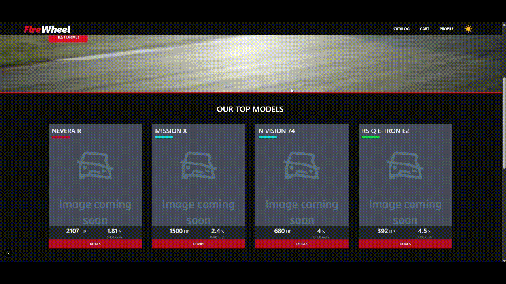
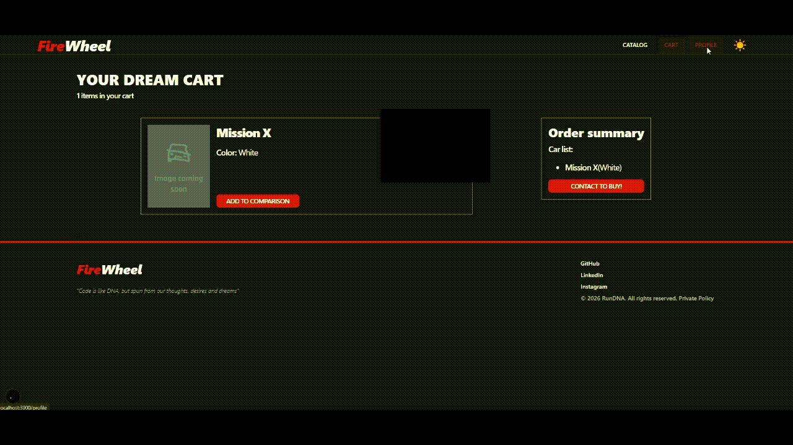

<div align="center">

# 🚗 React Car Shop (Microservices Architecture)

[]()
[]()
[](LICENSE)

_A containerized full-stack e-commerce platform for cars, built to explore microservices architecture, asynchronous task processing, and modern web technologies._

</div>

---

## 📌 Project Status & Learning Outcomes

This project served as an intensive hands-on sandbox for mastering **microservices design patterns, backend scalability, and modern frontend development**.

- **Current Status:** **Archived / Paused.** The core microservices and frontend migration have been successfully completed, and the project has fulfilled its educational purpose.
- **What's Done:** Fully operational microservices backend, containerized infrastructure via Docker, complete frontend rewrite to **Next.js**, HTTP-only cookie authentication, and the initial implementation of the Admin Panel.
- **What's Left Out / Not Implemented:** SEO optimization, full test coverage, and remaining views for the Admin Panel.

---

## 🏗 System Architecture

The application is split into decoupled microservices coordinated via an API Gateway, utilizing Redis for caching and message queuing.

```text
       [ Client (Next.js Frontend) ]
                    │
                    ▼
          [ Nginx API Gateway ]
        ┌───────────┼───────────┐
        ▼           ▼           ▼
   [ Catalog ]  [ Payment ] [ Auth (GraphQL) ]
        │           │           │
        └───────────┼───────────┘
                    ▼
    [ Fastify + BullMQ + Redis + PostgreSQL ]
    🛠 Tech Stack
Frontend
Framework: Next.js (App Router, Server/Client components)

Styling: Tailwind CSS / Modern CSS modules

<p align="center">
  
</p>

<p align="center">
  
</p>


Backend & Microservices
API Gateway: Nginx

Catalog Service: Express.js, PostgreSQL (Prisma ORM), Redis (Caching)

Payment Service: Express.js, PostgreSQL

Notification & Feedback Service: Fastify, BullMQ (Background job queues), Redis, PostgreSQL

Auth Service: GraphQL (Yoga), secure HTTP-only cookies for session management

DevOps & Infrastructure
Containerization: Docker & Docker Compose

Message Broker & Queue: Redis + BullMQ

✨ Key Features Implemented
Microservices Communication: Independent backend services communicating behind a single Nginx reverse proxy / API Gateway.

Next.js Migration: Fully refactored frontend from standard Vite/React to Next.js for better routing and performance capabilities.

Secure Authentication: Implementation of cookie-based authentication (HTTP-only cookies) via a dedicated GraphQL Auth Service.

Asynchronous Background Processing: Integrated BullMQ with Redis to handle queue-based tasks (notifications and feedback processing) smoothly without blocking the main event loop.

Admin Panel (Incomplete): Started structural implementation for product management and operational oversight.

Full Dockerization: Run the entire multi-container architecture locally using a single command.

🚀 Getting Started (Local Development)
Prerequisites
Docker & Docker Compose installed on your machine.

Node.js (v18+) if you want to run services locally outside containers.

Installation & Running
Clone the repository:

Bash
git clone [https://github.com/YourUsername/React-Car-Shop.git](https://github.com/YourUsername/React-Car-Shop.git)
cd React-Car-Shop
Configure Environment Variables:
Create .env files for each microservice based on their respective .env.example templates.

Spin up the infrastructure with Docker Compose:

Bash
docker-compose up --build
Access the application:

Frontend: http://localhost:3000 (or respective configured port)

API Gateway: http://localhost:8080

📚 What I Learned
Through building and eventually archiving this project, I gained deep practical experience in:

Designing distributed systems and separating monoliths into domain-driven microservices.

Implementing secure cookie-based auth flows in modern web apps.

Managing background job queues with BullMQ and Redis.

Writing clean API documentation and containerizing multi-service environments with Docker.

📜 License
This project is open-source and available under the MIT License.
```
